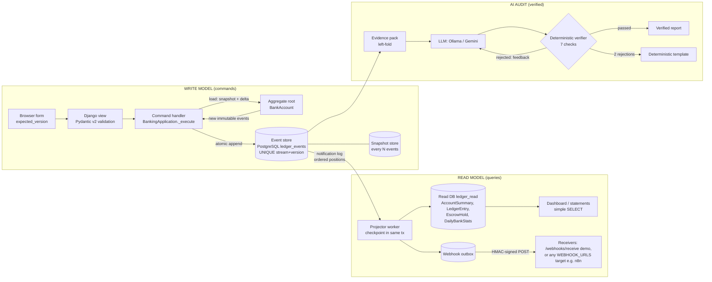
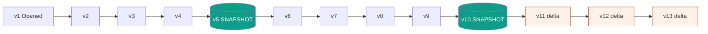
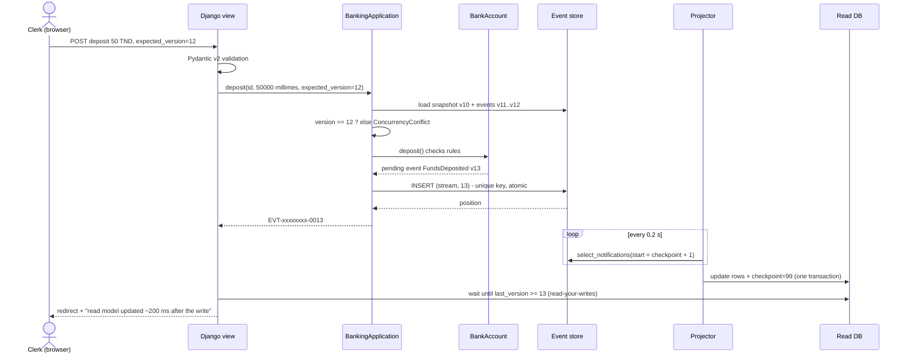

# Architecture diagrams (Mermaid source)

These diagrams render automatically on GitHub. To edit them, paste the code into https://mermaid.live,
or redraw them in draw.io or Excalidraw. The same diagrams appear as editable shapes in the PowerPoint.

## 1. Complete CQRS + Event Sourcing architecture

## 2. Aggregate reconstruction: snapshot + delta replay

To rebuild v13, the repository loads snapshot v10 (1 read) and replays only v11 to v13, instead of all 13 events.

## 3. Sequence: one deposit command, end to end

## References used for these diagrams
* eventsourcing library (v9.5.6): https://github.com/pyeventsourcing/eventsourcing
* documentation: https://eventsourcing.readthedocs.io/ (topics: domain, application, persistence, projection)
* Django persistence package evaluated as an alternative: https://github.com/pyeventsourcing/eventsourcing-django
